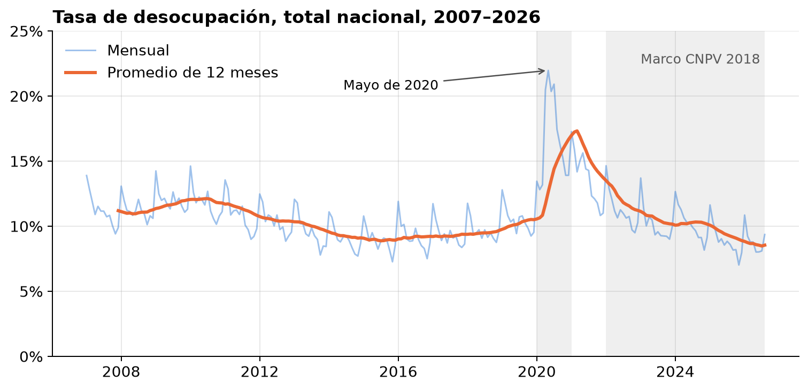

# DANE-data

[Documentación](https://integralindefinida.github.io/DANE-data/) · [PyPI](https://pypi.org/project/dane-data/)

Microdatos del DANE listos para analizar: la Gran Encuesta Integrada de Hogares (GEIH, 2007–2026), la
Encuesta Anual Manufacturera (EAM, 1992–2024), las Estadísticas Vitales (nacimientos y defunciones, 1979–2025), la
Encuesta de Micronegocios (EMICRON, 2019–2025), la Encuesta Nacional de Calidad de Vida (ECV, 2018–2025), con el Índice
de Pobreza Multidimensional, y la Medición de Pobreza Monetaria y Desigualdad (2012–2025).

[](https://integralindefinida.github.io/DANE-data/ejemplos/desempleo.html)

*La tasa de desocupación de cada mes desde 2007, calculada con dane-data a partir de los microdatos de la GEIH
([ejemplo completo](https://integralindefinida.github.io/DANE-data/ejemplos/desempleo.html)).*

Dos formas de usarlo:

| | Para quién | Cómo |
|---|---|---|
| Aplicación | Estudiantes que empiezan, clases, consultas rápidas | `dane-data app`, que se abre en el navegador |
| Librería de Python | Automatización, investigación, estudiantes avanzados | `import dane_data as dd` |

Ambas usan el mismo motor: descargan del ANDA del DANE, unen los módulos, armonizan las variables
entre épocas (nombres, separadores, coma decimal, factores de expansión, revisiones CIIU) y calculan
indicadores ponderados como lo hace el DANE.

## Instalación de la app

1. Descargue [dane-data.zip](https://github.com/IntegralIndefinida/DANE-data/releases/latest/download/dane-data.zip) (siempre la última versión).
2. Descomprímalo (en Windows: clic derecho → *Extraer todo…*; abrirlo con doble clic no basta) en una
   carpeta fuera de OneDrive, por ejemplo `C:\dane-data`: la primera vez se crean miles de archivos
   (`.venv/`) que OneDrive se pondría a sincronizar.
3. Haga doble clic en el lanzador de su sistema:

   | Sistema | Archivo |
   |---|---|
   | Windows | `Abrir dane-data.exe` (o `Abrir dane-data (Windows).bat`, que hace lo mismo) |
   | Mac | `Abrir dane-data (Mac).command` |
   | Linux | `abrir-dane-data.sh` |

La primera vez necesita internet y tarda 1–3 minutos: el lanzador instala [uv](https://docs.astral.sh/uv/),
que descarga Python 3.12 y las librerías exactas de `uv.lock` dentro de la carpeta (`.venv/`), sin tocar el
resto del sistema. Las siguientes veces abre en segundos. El navegador se abre solo; para cerrar la
app basta cerrar la ventana de la terminal.

> Primera vez en **Windows**: si aparece "Windows protegió su PC", haga clic en *Más información* → *Ejecutar de
> todas formas*. En **Mac**: si dice que no se puede verificar el desarrollador, cierre el aviso y abra
> *Configuración del Sistema* → *Privacidad y seguridad* → *Abrir de todos modos* (hasta macOS 14 bastaba
> con clic derecho → *Abrir* → *Abrir*).

## Instalación con pip

```bash
pip install "dane-data[app]"   # librería + aplicación
pip install dane-data          # solo la librería
dane-data app
```

## Instalación para desarrollo

```bash
git clone https://github.com/IntegralIndefinida/DANE-data
cd DANE-data
pip install -e ".[app]"        # librería + aplicación
# pip install -e .             # solo la librería
# o con uv:  uv run --extra app dane-data app
```

Requiere Python ≥ 3.10.

## La aplicación

```bash
dane-data app          # o doble clic en el lanzador; el navegador se abre solo
```

| Página | Qué hace |
|---|---|
| Inicio | Explica las encuestas, muestra qué datos hay y configura las carpetas |
| Descargar datos | Elige encuesta y años y descarga |
| Indicadores laborales | TD, TGP, TO, informalidad e ingresos, por sexo, edad, zona, educación o departamento; anual o mensual |
| Tablas y microdatos | Tablas ponderadas a la medida, distribución de ingresos frente al salario mínimo, exportación |
| Indicadores industriales | Producción, valor agregado, empleo, productividad y participación laboral por sector o departamento |
| Panel y microdatos EAM | Panel de establecimientos (balanceado o no), supervivencia, exportación |
| Pobreza monetaria | Incidencia, brecha y severidad de la pobreza y la pobreza extrema, Gini e ingreso per cápita, con la serie empalmada 2012–2025 |
| Nacimientos y defunciones | Indicadores de los tres certificados, tasas sobre la población y causas de muerte |
| Micronegocios | Indicadores de la EMICRON: ventas, valor agregado, empleo y registros, por ciudad o zona, sexo del propietario, actividad o sitio del negocio |
| Calidad de vida y pobreza | Indicadores de la ECV (servicios, internet, salud, educación, TIC) y el Índice de Pobreza Multidimensional, por área, región, departamento o sexo del jefe |
| Diccionario | Buscador de variables con las etiquetas y categorías oficiales del DANE |
| Cómo citar | La cita de dane-data y de los datos del DANE, en APA y BibTeX |

Cada tabla se descarga en CSV, Excel o Stata, y cada página muestra el código Python equivalente, que se
puede copiar a un notebook para seguir desde ahí.

Para usarla en un aula (el profesor la sirve y los estudiantes entran desde la red local):
`dane-data app --address 0.0.0.0`. La aplicación no tiene usuarios ni contraseña: cualquiera en esa red
puede cambiar las carpetas de datos, descargar y exportar en el computador del profesor. Úsela solo en
una red de confianza.

## La librería

```python
import dane_data as dd

# 1. ¿Dónde están (o estarán) los datos?  Se recuerda para siempre.
dd.set_paths(geih="~/datos/GEIH/data", eam="~/datos/EAM/data", save=True)

# 2. Descargar (incremental: lo ya bajado se salta)
dd.geih.download([2024, 2025])
dd.eam.download(range(2014, 2025))

# 3. Cargar: una persona por fila, módulos ya unidos y variables armonizadas
df = dd.geih.load(2025)                                  # todos los meses
df = dd.geih.load([2024, 2025], months=[1, 2, 3])        # primer trimestre
df = dd.geih.load(2025, columns=["P6500", "P7070"])      # + variables DANE extra
df = dd.geih.load(2016, empalme=True)                    # serie de empalme (marco 2018)
pocas = dd.geih.load(range(2015, 2026), variables=["fex", "sexo", "ocupado"])  # solo esas columnas

# 4. Indicadores laborales ponderados
dd.geih.indicadores(df)                                  # TGP, TO, TD, informalidad, ingresos…
dd.geih.indicadores(df, por=["sexo", "zona"])
dd.geih.indicadores(df, por="grupo_edad", anual=False)   # mensual
dd.geih.serie_indicadores(range(2007, 2027), por="sexo")  # precalculado por año, sin cargar microdatos
dd.geih.serie_indicadores(range(2015, 2027), filtros={"edad": (15, 28)})   # jóvenes

# 5. Tablas ponderadas de cualquier cosa
dd.tabla(df, por=["anio", "nivel_educativo"], estadistico="porcentaje")
dd.tabla(df[df.ocupado == 1], por="departamento", variable="ingreso_laboral", estadistico="mediana")
# lo mismo, año por año y guardado en caché (sirve para muchos años sin cargarlos en memoria)
dd.geih.serie_tabla(range(2007, 2027), por="departamento", variable="ingreso_laboral", estadistico="mediana",
                    poblacion="ocupado", filtros={"sexo": ["Mujer"]})
dd.geih.exportar(range(2015, 2026), "ocupados.csv", poblacion="ocupado")  # CSV armonizado, mes a mes

# 6. EAM
eam = dd.eam.load(range(2012, 2025))                     # un establecimiento-año por fila
dd.eam.resumen(eam, por=["anio", "sector"])              # VA, empleo, productividad, participación laboral
panel = dd.eam.panel(eam, balanceado=True)               # índice (nordest, anio)
dd.eam.supervivencia(eam)                                # % de plantas que reaparecen cada año
dd.eam.deflactar(eam, ["valagri"], ipp_por_anio)         # a precios constantes

# 7. Estadísticas Vitales: certificados de nacimiento y de defunción
dd.eevv.download(2025)
nac = dd.eevv.load(2025, tipo="nacimientos")             # un certificado por fila
dd.eevv.indicadores(nac, por="edad_madre")               # bajo peso, prematuros, cesáreas…
dd.eevv.tasas(range(2015, 2026), por="departamento")     # natalidad, mortalidad, fecundidad, mortalidad infantil
dd.poblacion(2025, sexo="Mujer", edades=(15, 49))        # las proyecciones del DANE, sin descargar nada

# 8. EMICRON: micronegocios (hasta 9 personas ocupadas)
dd.emicron.download(2024)
emi = dd.emicron.load(range(2019, 2025))                # un micronegocio por fila, módulos ya unidos
dd.emicron.indicadores(emi, por=["anio", "clase"])      # el cuadro I.1 del DANE: ventas, valor agregado, RUT…
dd.tabla(emi, por=["anio", "sitio"], estadistico="porcentaje")

# 9. ECV e Índice de Pobreza Multidimensional
dd.ecv.download(2025)                                    # los once capítulos del cuestionario
df = dd.ecv.load(2025, modulos=["salud", "educacion"])   # una persona por fila, capítulos unidos
dd.ecv.serie_indicadores(range(2018, 2026), por="area")  # servicios, internet, salud, educación… como el DANE
dd.ecv.serie_ipm(range(2018, 2026), por="departamento")  # incidencia, intensidad, IPM y las 15 privaciones

# 10. Pobreza monetaria: la serie empalmada 2012–2025 del DANE
dd.pobreza.download(empalme=True)
dd.pobreza.serie_indicadores(range(2012, 2026), empalme=True)   # incidencia, brecha, severidad, Gini
hog = dd.pobreza.load(2025)                              # un hogar por fila: ingreso per cápita, líneas, pobre
dd.pobreza.indicadores(hog, por="departamento", departamental=True)
per = dd.pobreza.unir_geih(dd.geih.load(2025))           # la pobreza del hogar en cada persona de la GEIH

# 11. Diccionario oficial
dd.buscar_variable("pensión")
dd.describir("P6920")
```

También en terminal:

```bash
dane-data estado                               # rutas y años/meses disponibles
dane-data descargar geih --anios 2024 2025
dane-data descargar geih --anios 2016 --empalme
dane-data descargar eam --anios 2022 2023 2024
dane-data descargar emicron --anios 2023 2024
dane-data descargar ecv --anios 2025 --modulos caracteristicas salud
dane-data config --geih RUTA --empalme RUTA --eam RUTA --ecv RUTA
```

Vea [Primeros pasos](https://integralindefinida.github.io/DANE-data/primeros_pasos.html) para un recorrido completo,
con los resultados de cada paso.

### Variables armonizadas

Las variables en minúscula las crea `dane-data` y significan lo mismo en todos los años. Las de
MAYÚSCULA (GEIH) son las originales del DANE.

**GEIH**: `anio`, `mes`, `fex`, `sexo`, `edad`, `grupo_edad`, `dpto`, `departamento`, `zona`,
`condicion` (Ocupado / Desocupado / Inactivo / Fuera de la PET), `pet`, `fuerza_trabajo`, `ocupado`,
`desocupado`, `inactivo`, `formal`, `formal_marco2005`, `cotiza_pension`, `ingreso_laboral`, `smlv`, `ratio_smlv`,
`horas_semana`, `posicion_ocupacional`, `rama2d`, `rama_rev`, `nivel_educativo`, `jefe_hogar`,
`ingreso_no_laboral`, `lugar_nacimiento`, `residencia_hace_12_meses`, `residencia_hace_5_anios`.

**EAM**: todas las columnas en minúscula, más `anio`, `ciiu`, `ciiu_rev`, `division`, `sector`,
`departamento`, `microagregado`, `grupo_microagregacion`.

**Estadísticas Vitales**: en todos, `anio`, `mes`, `sexo`, `departamento_ocurrencia`, `departamento_residencia`, sus códigos,
`mpio_ocurrencia`, `mpio_residencia`, `area_ocurrencia`, `area_residencia` y `regimen_salud`. En defunciones, además,
`grupo_edad`, `grupo_edad_amplio`, `menor_un_anio`, `neonatal`, `neonatal_precoz`, `causa_cie`, `cie_rev`, `causa_105`, `causa_667`, `gran_causa`,
`manera_muerte`, `materna`, `materna_tardia`, `sitio`, `estado_civil`, `nivel_educativo` y `etnia`. En nacimientos, `edad_madre`,
`madre_adolescente`, `peso_grupo`, `bajo_peso`, `gestacion_grupo`, `prematuro`, `cesarea`, `parto_multiple`, `consultas` y otras. En fetales, las de la madre y las causas, más `mortinato`.

**EMICRON**: la clave del propietario en la GEIH (`directorio`, `secuencia_p`, `secuencia_encuesta`), `anio`, `mes_ref`,
`fex`, `fex_dpto`, `departamento`, `ciudad`, `clase`, `sexo`, `edad`, `situacion_empleo`, `actividad`, `actividad12`,
`trabajadores_remunerados`, `socios`, `familiares_sin_remuneracion`, `personal_ocupado`, `rut`, `camara_comercio`,
`salud_pension`, `sitio` y los montos mensuales del DANE (`ventas_mes_anterior`, `consumo_intermedio`, `valor_agregado`,
`ingreso_mixto`, `sueldos`, `prestaciones`, `remuneracion_total`).

### Lo que `dane-data` resuelve por usted

| Problema en los archivos del DANE | Solución |
|---|---|
| 2007–2021: cada módulo partido en Área / Cabecera / Resto | Nacional = Cabecera + Resto (Área es un subconjunto de Cabecera) |
| Separadores `;` `,` `\t`, UTF-8 / Latin-1, coma decimal, blancos `" "` | Detección automática; columnas numéricas quedan numéricas |
| Factor de expansión `FEX_C_2011` / `FEX_C` / `FEX_C18` | Unificado en `fex` |
| Sexo en `P6020` o `P3271`, educación en `P6210` o `P3042`, rama en `RAMA2D` o `RAMA2D_R4` | Unificados fila a fila (sirve al juntar años de distintas épocas) |
| 2007 sin marcas `OCI`/`DSI`; 2020 y empalme con marcas en Características | La condición se deduce del módulo en que aparece cada persona |
| Archivos en subcarpetas (`CSV 13/No ocupados.CSV`) | Búsqueda recursiva |
| Nombres con erratas: «Deocupados» (2013), «Desoucpados», «Inativos» (octubre de 2020; septiembre en el empalme), «Fuerzo de trabajo» (noviembre de 2020) | Se reconocen igual |
| Meses a los que les falta un módulo | Se omiten con aviso (si no, el desempleo saldría 0 %); `incluir_incompletos=True` los carga |
| Marzo–julio de 2020 sin Vivienda, Otras actividades, Otros ingresos ni (serie principal) Desocupados e Inactivos: formulario telefónico | Se cargan con un aviso: las variables de esos módulos quedan vacías en esos meses |
| Varios meses juntos | Niveles = promedio mensual, como el DANE |
| EAM: `CIIU2N4`, `ciiu2`, `CIIU`, `ciiu3`, `ciiu4`, `ciiu_4`, códigos a 2–3 dígitos | `ciiu`, `ciiu_rev`, `division`, `sector` |
| EAM: valores reemplazados por el promedio de un grupo de establecimientos | Marcados en `microagregado`; `dd.eam.panel(..., excluir_microagregados=True)` |
| EMICRON: un ZIP por módulo y año; factor de 2019–2021 en un archivo aparte | Módulos unidos por la clave; `fex` es el factor de la serie vigente en todos los años |
| EMICRON: la clave del módulo de personal ocupado con los nombres corridos | `load_personal` la corrige |

Las cargas de la GEIH se guardan en caché (`~/.cache/dane_data`, parquet): un año completo tarda ~6 s la
primera vez y ~1 s después. Los resultados de `dd.geih.serie_indicadores`, `serie_tabla` y
`serie_frecuencias` se calculan un año a la vez y se guardan por año: toda la serie 2007–2026 tarda alrededor
de un minuto la primera vez y es instantánea después. Se recalculan solos si cambia algún archivo del año,
la consulta (filtros, meses, variables) o el código de dane-data. Todas las tablas y gráficas de la app salen
de ahí, así que la app nunca tiene más de un año de microdatos en memoria. `dd.geih.clear_cache()` borra
estas cachés.

### Validación

Con los datos reales, TD, TGP, TO y ocupados de cada mes de 2007–2026 y del empalme 2010–2020 coinciden
con los anexos del DANE, con diferencias menores a 0,01 puntos. También coinciden las cabeceras y cada sexo
donde el DANE los publica por mes, y las tasas anuales, que son el promedio de los niveles mensuales. Por
ejemplo, la desocupación promedio fue 10,5 % en 2019 y 10,2 % en 2023. Las pruebas (`pytest`) usan datos
sintéticos con las rarezas de cada época. Si encuentran los datos reales, también los comparan mes a mes con
las cifras publicadas (`tests/datos/dane_publicado.csv`) y buscan huecos o saltos bruscos en la serie.

En las Estadísticas Vitales, el total y el sexo de los tres certificados en 2008–2025 y los 33 departamentos en 2019–2025
coinciden exactamente con los cuadros definitivos del DANE. Antes de 2008 no hay cuadros en la página del DANE con qué
comparar.

En la EMICRON, 8 507 cifras de los anexos anuales vigentes (nacional 2019–2024 y 24 ciudades 2019–2025: micronegocios por
situación en el empleo, sexo, actividad, sitio, salud y pensión, RUT y Cámara de Comercio, y el cuadro I.1 con el
personal ocupado, las ventas, el valor agregado y el ingreso mixto) coinciden con una tolerancia relativa de una
milmillonésima, salvo tres diferencias de 2019 que están abajo, en las diferencias con la documentación del DANE. También
las 5 330 de los anexos departamentales de 2020–2024 (24 departamentos y Bogotá, con `fex_dpto`), salvo una errata del
anexo. Las trimestrales no: usan factores trimestrales que no vienen en los microdatos.

En la ECV, los 27 indicadores de la serie 2018–2025 del DANE coinciden exactamente en el total nacional y por área, y a menos
de 0,1 puntos por departamento. Las 15 privaciones del IPM coinciden hogar por hogar con la base oficial del DANE en 2018,
2019, 2023, 2024 y 2025, y en 2020–2022 salvo 5, 25 y 3 hogares (el IPM nacional de 2025 da 9,9 % y 0,040, y el de 2020,
18,1 %, como lo publicado).

En la pobreza monetaria, la serie empalmada 2012–2025 coincide con los anexos del boletín de junio de 2026: las 5 644 cifras
que se pueden comparar (incidencia, brecha y severidad de la pobreza y la pobreza extrema, Gini, ingreso per cápita, líneas,
población y pobres, nacional, por grandes dominios, 23 ciudades y 24 departamentos) quedan dentro del redondeo publicado.

## Advertencias metodológicas

- **Informalidad**: `formal` replica la medición oficial del DANE (17.ª CIET) con el código que el DANE
  publica en el anexo de *Empleo informal y seguridad social*: los formales e informales de cada mes desde
  2022 coinciden con los publicados. Antes de 2022 el cuestionario no tenía esas preguntas, y `formal` y
  `tasa_informalidad` quedan vacías (la serie oficial empieza en 2021, con la encuesta paralela, que no
  está en el ANDA). Para 2007–2021, `formal_marco2005` y `tasa_informalidad_marco2005` replican la medición
  anterior del DANE (empresas de hasta 5 personas), que coincide con la publicada para 13 y 23 ciudades.
  Las dos mediciones no son comparables entre sí.
- **Serie principal vs. empalme**: para series largas 2010–2020 comparables con 2021+, use `empalme=True`.
- **PET**: desde 2022 son las personas de 15 años o más; antes, 12+ (urbano) y 10+ (rural).
- **Ingresos**: `INGLABO` en pesos corrientes; la GEIH 2007 no lo trae. `ingreso_no_laboral` suma, sin
  imputar, las fuentes no laborales que el DANE cuenta en la pobreza monetaria, así que no da sus cifras.
- **EAM**: los montos vienen en miles de pesos corrientes. Según los propios archivos, la CIIU es
  Rev. 2 hasta 2000, Rev. 3 en 2001–2011 y Rev. 4 desde 2012 (la documentación del ANDA dice otra
  cosa; vea las diferencias con la documentación del DANE); los sectores no se comparan entre revisiones sin una
  correlativa.
- **EAM, composición por sector**: para anonimizar, el ANDA publica muchos establecimientos grandes con el
  código residual «otras industrias manufactureras» (3909, 3699 o 3290) o con el código truncado a 2–3
  dígitos. Los totales nacionales y por departamento coinciden con el DANE, pero la división residual sale
  inflada y las demás, subestimadas: en 2024 la división 32 suma el 11,0 % del valor agregado (2,2 % en el
  anexo del DANE) y bebidas el 5,3 % (9,7 %). Para la composición por sector, use los anexos del DANE.
- **EAM, análisis por establecimiento**: cada año, los valores de 13–25 % de los establecimientos, que suman
  la mitad del valor agregado o más, son el promedio de un grupo de establecimientos (casi siempre 3), no los
  propios. Sirven para agregados; para productividad, funciones de producción o paneles por planta,
  excluya o controle los registros `microagregado` (`dd.eam.panel(..., excluir_microagregados=True)`).
- **ECV, IPM de 2020**: con los colegios cerrados, el DANE armó la inasistencia escolar de 2020 con su base
  complementaria (estrategias de estudio en casa). `dd.ecv.download(2020)` la baja; sin ella, la incidencia de 2020 sale
  14,8 % y no 18,1 %, y `privaciones` avisa.
- **Estadísticas Vitales, tasas**: `dd.eevv.tasas` usa hechos registrados, sin ajustar por subregistro, así que no tiene por
  qué coincidir con los indicadores demográficos del DANE, que salen de un modelo. Los años antiguos salen más bajos que los
  reales. Por departamento y área se usa la residencia, y quedan por fuera los residentes en el extranjero y quienes no
  tienen el dato. Cada tasa sigue la fórmula de su ficha técnica del DANE (2026): la razón de mortalidad materna cuenta solo
  las muertes de hasta 42 días (sin O96 ni O97), y la mortalidad perinatal, los mortinatos y no todas las defunciones fetales.
- **Estadísticas Vitales, fuentes desde 2022**: además de los certificados del sector salud entran registros de la
  Registraduría y formatos de notificación étnica (`TIPOFORMULARIO`). Están en los conteos, como en los cuadros del DANE, pero
  los de la Registraduría no traen consultas, peso, sitio del parto ni departamento de residencia (1,7 % de los nacimientos
  de 2025).
- **Estadísticas Vitales, comparación en el tiempo**: las causas básicas pasan de CIE-9 a CIE-10 en 1997 (use `causa_105`
  para series largas), los archivos de 1979 y 1980 están incompletos, y enero–junio de 1991 no separa las edades de los
  menores de 10 años. El registro fue mejorando: parte de los cambios, sobre todo en defunciones fetales hasta 2012, es mejor
  cobertura.
- **Estadísticas Vitales, prematuridad**: solo se puede saber con `T_GES_AGRU_CIE`, que no está en 2012, 2013, 2020 ni antes de
  2008. `T_GES` agrupa «de 28 a 37» semanas, que mezcla prematuros con nacidos a término.
- **EMICRON, cobertura**: 2019–2024 cubren el total nacional (sin Amazonas, Arauca, Casanare, Guainía, Guaviare,
  Putumayo, Vaupés ni Vichada) y 2025 solo las 24 ciudades: para una serie con 2025, use las 24 ciudades en todos los
  años. 2025 no trae factor departamental (`fex_dpto`): `dd.emicron.indicadores` y `dd.tabla` dejan fuera esos
  registros con un aviso, en vez de contarlos como cero.
- **EMICRON, montos**: son mensuales y en pesos corrientes; `dd.emicron.indicadores` los da anuales y en miles de pesos,
  como el DANE. 2019 solo trae las ventas: consumo intermedio, valor agregado, ingreso mixto y remuneraciones quedan
  vacíos. El factor de expansión es anual (la suma del año es el total), y por eso el mes se llama `mes_ref`: con una
  columna `mes`, `dd.tabla` promediaría los meses como en la GEIH.
- **Muestras pequeñas**: con menos de ~100 observaciones (`n_muestra`) las cifras no son confiables.
- El salario mínimo histórico (`dd.SMLV`) está tomado de los decretos; verifíquelo antes de publicar.

## Diferencias con la documentación del DANE (ANDA)

Cuando los datos contradicen la documentación oficial del ANDA (diccionarios DDI, etiquetas de
categorías), `dane-data` sigue los datos y lo anota aquí. El buscador de variables
(`dd.buscar_variable`, `dd.describir` y la página *Diccionario de variables*) muestra el DDI tal como lo publica
el DANE, así que en estos casos no coincide con las variables armonizadas.

### GEIH

| Variable | Qué dice el ANDA | Qué muestran los datos y qué hace `dane-data` |
|---|---|---|
| `P6430`, `P6870`, `OFICIO` → `formal_marco2005` (2007–2021) | La metodología de informalidad de 2009 cuenta como informales a todos los empleados domésticos, trabajadores sin remuneración y jornaleros, y a los cuenta propia de empresas de hasta 5 personas «excepto los independientes profesionales», sin decir cómo se identifican. | Lo publicado por el DANE (anexo de octubre a diciembre de 2021, trimestres móviles de 2007–2019 y 2021) solo coincide si domésticos, trabajadores sin remuneración y jornaleros son informales cuando también están en empresas de hasta 5 personas, como dice la presentación de la nueva medición (julio de 2022), y si los profesionales son los oficios 1 a 20 de la CNO (profesionales, técnicos y directivos; el 0 no). `dane-data` sigue lo publicado: coincide en todos los trimestres en las 13 ciudades y en las 23 salvo febrero de 2008, con 134 informales menos de unos 4,6 millones (Tunja, Quibdó, Riohacha y Armenia; no se encontró el registro). |
| `P7500S1A1`–`P7510S5A1` → `ingreso_no_laboral` | El DDI presenta los montos como «Valor $», sin códigos especiales. | En todos los años hay montos de 98 y 99 que no son pesos sino «no sabe» y «no informa», como el 9 de las preguntas sí/no (en enero de 2024, 448 personas de la PET tienen alguno). `dane-data` deja vacío su `ingreso_no_laboral`. Deducido de los datos; el DANE no lo dice. |
| `P3373` → `lugar_nacimiento` (desde 2022) | El DDI no trae categorías para «¿Dónde nació?». | Toma los valores 1, 2 y 3. Con el 2 se llenan el departamento y el municipio (`P3373S1`, `P3373S2`) y con el 3 el país (`P3373S3`), así que son este municipio, otro municipio y otro país, en el orden de `P3384`, que sí las trae (corridas en uno por «No había nacido»). `dane-data` las etiqueta así. Deducido de los datos. |
| `P3068` → `formal` (desde 2023) | El DDI da tres categorías: 1 = sí, 2 = no y 9 = no sabe, no informa. | En 2022 los datos usan el 9. Desde enero de 2023 el 9 no aparece y viene en su lugar un 3, que el DDI no trae (de 1 a 8 personas encuestadas en casi todos los meses). El código SAS del anexo de informalidad del DANE trata el 3 como el 9 («se agrega la opción 3 ya que esta reemplaza al 9 desde 2023»), y `dane-data` también: en esa regla los dos cuentan como informales. |
| `OFICIO_C8` → `formal` (desde 2022) | El código SAS del anexo de informalidad toma los dos primeros caracteres del código de oficio, de 4 dígitos (`SUBSTR(OFICIO_C8,1,2)`), y cuenta como formales a los independientes de los grupos 00 a 20. El DDI no describe la variable. | Los archivos del ANDA lo traen como número, sin el cero inicial: `110` es el código `0110`, y `0` es `0000` (en junio de 2024, 34 de unos 30 000 ocupados encuestados). Sin completarlo, los dos primeros caracteres de `110` serían `11` y el `0` no quedaría en ningún grupo. `dane-data` lo completa a 4 dígitos antes de tomar los dos primeros; así los formales e informales de cada mes de 2022 a 2026 coinciden con el anexo. Deducido de los datos; el DANE no lo dice. |
| `P6430` → `posicion_ocupacional` (desde 2022) | El DDI de 2022 (catálogo 771) y el de 2025 (catálogo 853) repiten las 9 categorías del cuestionario anterior: 7 = trabajador sin remuneración en negocios de otros hogares, 8 = jornalero o peón, 9 = otro. | Desde enero de 2022 el código 7 es "jornalero o peón" (100 % agropecuario y casi todos con ingreso), el 8 es "otro" y el 9 ya no aparece. Hasta 2021, y en el empalme, se usan las etiquetas anteriores, que sí coinciden con los datos. El código 6 se sigue llamando "familiar sin remuneración"; desde 2022 podría incluir también el trabajo sin remuneración en negocios de otros hogares (sin confirmar). El código de informalidad que publica el DANE también trata el 7 como asalariado, junto al 1. |
| `FEX_C_2011` → `fex` (2008 y 2011, archivos CSV) | Los CSV de los catálogos 206 (2008) y 182 (2011) deberían traer el mismo factor de expansión que las versiones TXT y SPSS de esos catálogos. | Los CSV perdieron el punto decimal y traen puntos de miles: `849.491.032.387.525` es 84,9491032387525 en el TXT. Como la parte entera tiene de 1 a 5 dígitos, el valor no se puede recuperar del CSV. Algunos archivos traen además filas con un campo de más. Se confirmó persona por persona en marzo de 2011 contra el TXT. Para esos años `dane-data` descarga la versión TXT (tabulada) del mismo catálogo. Si en la carpeta solo están los CSV dañados, esos meses se omiten con un aviso para volver a descargarlos. |
| Celdas vacías (septiembre a diciembre de 2017, catálogo 458, archivos CSV) | Se publica como CSV, igual que los demás meses de 2017, que dejan en blanco las celdas sin dato. | Los 24 archivos de cada uno de esos meses escriben las celdas sin dato como `1.79769313486232e+308` (el mayor número de doble precisión redondeado a 15 cifras, que se lee como infinito). En septiembre, por ejemplo, 4.327 ocupados tienen ese valor en `INGLABO`, y esos valores más las celdas vacías suman lo mismo que las celdas vacías de agosto, en cada columna. `dane-data` lo lee como vacío; antes dejaba `ingreso_laboral`, `ratio_smlv` e `ingreso_no_laboral` en infinito para esas personas. Deducido de los datos; no se revisaron las versiones TXT y SPSS del catálogo. |
| Septiembre de 2021 (catálogo 701, `Septiembre.csv (2) (1).zip`) | Se publica como CSV. | Los archivos vienen separados por espacios, y el texto libre también tiene espacios, así que las columnas no se pueden separar. `dane-data` descarga ese mes en Stata (`Septiembre.zip`, del mismo catálogo). Si solo está el CSV, el mes se omite con un aviso para volver a descargarlo. |
| `PETI` → `pet` (empalme, octubre de 2012, catálogo 760) | Las cifras publicadas de la serie con proyecciones del CNPV 2018 usan la PET de 15 años o más en todos los meses. | El archivo de octubre de 2012 marca la PET con la definición anterior (12+ urbano, 10+ rural): la PET sube 9 % frente a septiembre y aparecen ~400 mil ocupados menores de 15 años. Con la PET del archivo, la TGP de ese mes saldría 64,5 % frente al 69,1 % publicado. `dane-data` aplica a todo el empalme la PET de 15 años o más (`harmonize(..., edad_minima_pet=15)`), lo que solo cambia octubre de 2012: así los 132 meses del empalme coinciden con el anexo del DANE. |
| `P6020` → `sexo` (empalme, abril y mayo de 2017, catálogo 763) | Las cifras mensuales por sexo del anexo (hoja "Total_nacional_IML_Sexo") suman el total nacional. | Son todos los hogares de Putumayo de esos meses (320 y 359 personas): solo traen edad y factor de expansión, y el resto de las características (sexo, parentesco, salud, educación) viene en blanco, también en las versiones Stata y SPSS del mismo ZIP. No se pueden recuperar: no están en ningún otro mes del empalme ni en la serie principal, y el catálogo de nuevos departamentos de 2017 (562) no tiene Mocoa en abril ni mayo (posiblemente por la avalancha del 31 de marzo; sin confirmar). `dane-data` deja `sexo` vacío para ellos: los totales coinciden con lo publicado, pero los ocupados de cada sexo quedan cerca de 0,1 % por debajo (unos 16 mil en total). |

### EAM

| Variable | Qué dice el ANDA | Qué muestran los datos y qué hace `dane-data` |
|---|---|---|
| `ciiu` → `ciiu_rev`, `sector` (2000 y 2012) | La descripción del estudio (catálogos 491 a 888) dice que "en el año 2000 se incorpora en la EAM la CIIU Rev.3" y que la Rev. 4 se oficializó "con la difusión de las cifras referentes al año 2013". En otro pasaje del mismo texto los cambios de la Rev. 4 se ubican "a partir del año 2012". | El archivo de 2000 trae la variable `ciiu2` con códigos Rev. 2 (solo divisiones 31–39, igual que 1992–1999); la Rev. 3 aparece en 2001. El archivo de 2012 ya trae `ciiu4` con códigos Rev. 4 (divisiones 10–14, que no existen en la Rev. 3). `dane-data` asigna la revisión según la variable de cada año: Rev. 2 hasta 2000, Rev. 3 en 2001–2011 y Rev. 4 desde 2012. |
| Cobertura por división (archivos de 1995 en adelante) | La descripción de cada archivo dice que comprende "desde la división 11 a la 33 de la CIIU REV.4", también en los de 1995–2011. | Los archivos de 1995–2000 están en Rev. 2 (divisiones 31–39) y los de 2001–2011 en Rev. 3 (15–37). Los años en Rev. 4 incluyen la división 10, alimentos, que es el 18 % de los establecimientos en 2012–2024; el de 2012 incluye además las divisiones 58, 59 y 73. `dane-data` conserva todas las divisiones de cada archivo. |
| `ciiu`, `division`, `sector` (todos los años) | Los catálogos solo dicen que son "microdatos anonimizados de uso público", sin describir el método. El DDI de `CIIU4` describe 3290 como una clase más ("Otras industrias manufactureras n.c.p.") y no tiene códigos de 2 o 3 dígitos. | Para anonimizar, el ANDA publica muchos establecimientos, sobre todo grandes, con el código residual de la revisión: 3909 en 1995–2000 (Rev. 2), 3699 en 2001–2011 (Rev. 3) y 3290 en 2012–2015 y 2018–2024 (Rev. 4). En 1992–1994 y 2016–2017, en cambio, trunca el código a 2 o 3 dígitos, que conservan la división. Los totales nacionales y por departamento coinciden con los anexos del DANE, pero la composición por división no. En 2024 el anexo trae 224 establecimientos en el grupo 329 (1,6 % del valor agregado) y los microdatos, 530 con 3290 (10,5 %). Bebidas baja de 9,7 % a 5,3 %, y la división 32 sube de 2,2 % a 11,0 %. En 1998 el anexo trae 69 establecimientos en la clase 3909 y 8 refinerías (grupo 353); los microdatos, 532 en 3909 y ninguna refinería. En 2008–2011 el anexo trae 131–141 en la 3699 (0,4–0,6 % de la producción bruta) y 4 o 5 refinerías (2321, 10–13 %); los microdatos, 566–600 en la 3699 (20–23 %) y ninguna refinería. `dane-data` deja `ciiu` como lo publica el ANDA y solo lo advierte (aquí, en la guía de la EAM y en la aplicación al desagregar por sector): no marca esos registros ni intenta deducir su actividad, para no deshacer la anonimización. Comparado con los anexos de 1998, 2008–2011 y 2024; para los demás años se deduce de la participación del código residual en los microdatos (9–32 % del valor agregado, frente a 1,4–3,6 % en los años que truncan). |
| Valores de cada establecimiento → `microagregado`, `grupo_microagregacion` (todos los años) | Los catálogos solo dicen que son "microdatos anonimizados de uso público". El DDI describe cada variable (`valagri`, `pertotal`...) como el valor del establecimiento. | Cada año, entre 1 021 y 1 797 registros (13–25 %) vienen en grupos de establecimientos del mismo departamento y CIIU que comparten exactamente todos los montos de `CORE` (producción, consumo intermedio, valor agregado, personal, salarios, activos, energía...). En 1992–2024 hay 13 462 grupos de 3, 1 412 de 4, 268 de 5 y 48 de otros tamaños (de 2 a 11); solo 32 de los 15 190 juntan establecimientos de una misma empresa. Suman 49–77 % del valor agregado del año, porque son sobre todo establecimientos grandes. Todo indica que cada valor es el promedio del grupo: en 1998, 1999, 2002 y 2006 los únicos montos con decimales son de estos registros, con fracciones como ,6666667 o ,3333333 (tercios), y las sumas coinciden con los anexos. Las ventas (`valorven`) a veces difieren dentro del grupo (1 de 541 grupos en 2024), así que no entran en la comparación. `dane-data` no cambia los valores: `microagregado` marca los registros de un grupo y `grupo_microagregacion` numera el grupo dentro de cada año. `dd.eam.panel` avisa cuántos establecimientos del panel tienen registros microagregados y los quita con `excluir_microagregados=True`. Deducido de los microdatos; el DANE no lo ha confirmado. |
| Títulos de los catálogos 871 y 888 | El título de ambos catálogos en el DDI es "EAM_2022". | Sus archivos son de 2023 (871) y 2024 (888), como dice la versión de cada archivo. `dane-data` descarga 2023 del 871 y 2024 del 888. |

### Estadísticas Vitales

| Variable | Qué dice el ANDA | Qué muestran los datos y qué hace `dane-data` |
|---|---|---|
| `GRU_ED1` → `grupo_edad`, `menor_un_anio` (defunciones, enero–junio de 1991, catálogo 396) | El DDI da el mismo esquema de 25 grupos que en 1979–1990: del 1 al 5, menores de un año. | Esos seis meses casi no tienen códigos del 1 al 5 (56 registros en total, frente a unos 1 000 por mes en el segundo semestre): las muertes de menores de 10 años, también las de causa perinatal, están en el 6, 7 y 8, sin poder separarse. Salen como «Menor de 10 años, sin detalle»; `menor_un_anio` queda vacía y `tasas` no da mortalidad infantil para 1991. `load` lo avisa. |
| `GRU_ED1`, códigos 6 y 7 (defunciones 1979–1990, catálogo 396) | 6 = «de un año» y 7 = «de 2 a 4 años». | Por confirmar. Los dos no empalman con 1992, aunque su suma sí: en 1990 valen 3 126 y 1 074, y en 1992, 2 070 y 2 059. `grupo_edad` solo usa la suma («De 1 a 4 años»). El código original se puede cargar con `columns=["GRU_ED1"]`. |
| `GRU_ED1`, código 15 (defunciones 1998–2007, catálogo 366) | «De 35 a 99 años». | Es una errata: es de 35 a 39 años, como confirman su tamaño y los grupos vecinos. `grupo_edad` lo trata así. |
| Cobertura de 1979 y 1980 (defunciones, catálogo 396) | El catálogo presenta la serie 1979–1991 sin distinguir años. | En 1979 faltan Caldas, Norte de Santander, Quindío, Risaralda, Santander y Arauca (de 1 a 3 registros de ocurrencia o ninguno), y en 1980 Caldas, Quindío y Risaralda traen cerca de la mitad de lo de 1981. Esos totales nacionales no son comparables. `load`, `tasas` y `serie_*` lo avisan; los datos se dejan como están. |
| `COD_DPTO`, `CODPTORE` → `dpto_*`, `departamento_*` (defunciones 1979–1981, catálogo 396) | El DDI no trae el código 83. | Por confirmar, porque es una deducción: 83 tiene entre 1 280 y 1 480 registros de ocurrencia por año en 1979–1981 y ninguno después, y 18 (Caquetá) ninguno antes de 1982 y 1 500 ese año. `dane-data` lo lee como Caquetá. |
| Costa Caribe en 1983 (defunciones, catálogo 396) | Nada. | Por confirmar: Atlántico, Bolívar, Cesar, Magdalena y Sucre suben de 13 879 defunciones en 1982 a 19 681 en 1983 y vuelven a 13 491 en 1984, en todos los meses y sin más duplicados que otros años. El total nacional casi no se mueve, porque el resto del país baja. Los datos se dejan como están. |
| `NIV_EDUM` → `nivel_educativo_madre` (fetales 2009, catálogo 375) | El mismo esquema de 2008–2011: 13 = ninguno, 99 = sin información. | Casi no aparecen ni el 13 (6 registros) ni el 99 (213), y el 9 sube a 7 005, frente a 3 019 en 2008. No se sabe qué es cada código, así que `nivel_educativo_madre` queda vacía ese año. El código original se puede cargar con `columns=["NIV_EDUM"]`. |
| `N_HIJOSM` (fetales 1998, catálogo 366) | Número de hijos nacidos muertos. | 10 995 de los 16 004 registros traen el texto «Número de hijos nacidos muertos» y 2 546 «Sin información», en vez de un número. No es una variable armonizada; si se carga con `columns=["N_HIJOSM"]`, llega como texto. |
| `MUL_PARTO` → `parto_multiple` (nacimientos 2008–2011 y 2014–2019) | «Sin información» es el 5. | En los datos siempre es el 9, como en los demás años, y el 5 no aparece. `parto_multiple` deja vacíos los dos. |
| `CAUSA_667`, `CAU_HOMOL` → `causa_667_nombre`, `causa_105_nombre` (toda la serie) | El DDI trae los códigos sin nombre. | Los nombres salen de los cuadros de defunciones del DANE. `CAUSA_666` (hasta 2018) es otra lista, aunque se parezca: el 407 de una es el 406 de la otra, así que `causa_667` queda vacía donde solo está `CAUSA_666` y `gran_causa` usa su primer dígito, que sí coincide (el 7 de la 6/66 es el 0 de la 6/67). |
| `PESO_NAC` → `mortinato`, `mortalidad_perinatal` (fetales, toda la serie) | La ficha técnica de la tasa de mortalidad perinatal del DANE (2026) cuenta como mortinato la defunción fetal de 22 semanas o más **o** de 500 gramos o más. | Los microdatos agrupan el peso desde «menos de 1.000 gramos» (los cuadros del DANE sí separan de 300 a 999), así que con menos de 22 semanas, o sin gestación, no se puede saber si pesaba 500 gramos. `mortinato` es True con 22 semanas o más o con 1.000 gramos o más, False con menos de 22 semanas y de 1.000 gramos (el DANE contaría las de 500 a 999), y vacío sin gestación y con menos de 1.000 gramos: 2 309 de las 19 620 defunciones fetales de 2025. Por eso `mortalidad_perinatal` puede quedar algo por debajo de la del DANE. |
| Defunciones fetales antes de 1998 | La ficha metodológica V10 (DSO-EEVV-FME-001) dice que hay microdatos anonimizados de defunciones fetales desde 1992. | En el ANDA, los catálogos de 1992–1996 (397) y 1997 (398) solo traen `Defun1992.zip` a `Defun1997.zip`, y esos archivos no tienen `TIPO_DEFUN` ni grupos de edad fetales: son solo defunciones no fetales. `dane-data` ofrece las fetales desde 1998, el primer año que hay en el ANDA. |

### EMICRON

| Variable | Qué dice el ANDA | Qué muestran los datos y qué hace `dane-data` |
|---|---|---|
| `F_EXP` → `fex` (2019–2021, catálogos 681, 712 y 742) | Cada módulo trae `F_EXP`, «Factor de expansión», y el catálogo publica además un «Factor de expansión ajustado» (y en 2019–2020 uno con «proyecciones CNPV»), sin decir cuál usan las cifras vigentes. | Las cifras vigentes son las de los anexos «actualizado-abr2023», y salen del factor ajustado: con él 2019 suma 5 215 035 micronegocios, igual que el anexo, y con `F_EXP` 5 874 177, el anexo anterior. `dane-data` usa el ajustado en 2019–2021 y `F_EXP` desde 2022; así los totales de los siete años coinciden con lo publicado. El de «proyecciones CNPV» no se baja. |
| `SECUENCIA_PH`, `SECUENCIA_P`, `SECUENCIA_ENCUESTA` (módulo de personal ocupado, todos los años) | `SECUENCIA_P` y `SECUENCIA_ENCUESTA` tienen el mismo nombre y la misma etiqueta que en los demás módulos, y `SECUENCIA_PH` es «Secuencia PH». | Los nombres están corridos: `SECUENCIA_PH` es el `SECUENCIA_P` (hogar) de los demás módulos, `SECUENCIA_P` es su `SECUENCIA_ENCUESTA` (el propietario) y `SECUENCIA_ENCUESTA` numera a las personas del micronegocio. Con los nombres tal como vienen, solo la mitad de las filas encuentra su micronegocio; con la correspondencia, todas, y sumadas por tipo dan las cifras del DANE. `load_personal` la corrige y numera a la persona en `orden`. Deducido de los datos. |
| `GRUPOS4`, `GRUPOS12` → `actividad`, `actividad12` (2019, catálogo 681) | Los cuadros B.1 y B.2 del anexo de 2019 dan 539 233 micronegocios en la industria manufacturera y 432 670 en alojamiento y servicios de comida. | Los microdatos traen 587 782 y 384 121: unos 48 549 micronegocios que el anexo pasa de la industria a alojamiento y comida (en B.1, de industria a servicios). Las demás actividades coinciden. Sin el código CIIU, que no viene en los microdatos, no se pueden separar. `dane-data` deja la actividad como la traen los microdatos. Desde 2020 coincide con los anexos. |
| `P3032_1` → `trabajadores_remunerados` (2019, catálogo 681) | El cuadro I.1 del anexo de 2019 da 1 187 591 trabajadores remunerados. | `P3032_1` da 1 185 069 (0,2 % menos), y el anexo coincide con las filas del módulo de personal ocupado (`load_personal`). Desde 2020 las dos fuentes coinciden. `dane-data` usa `P3032_1`, que está en la fila de cada micronegocio; el personal ocupado de 2019 queda 0,03 % por debajo. |
| Montos de 2019 (catálogo 681) | El cuadro I.1 del anexo de 2019 trae consumo intermedio, valor agregado, remuneraciones e ingreso mixto. | Los módulos de 2019 no traen esas variables calculadas (sí `VENTAS_MES_ANTERIOR`, que coincide con el anexo), y el DANE no publica cómo se arman con las preguntas. `dane-data` las deja vacías en 2019; `indicadores` lo avisa. |
| Factor departamental → `fex_dpto` (2019–2024) | Un archivo de factores departamentales por año. | Se llama `FEX_MICRO_DPTO` en 2019–2022 y `FEX_C` en 2023–2024 (el mismo nombre que el factor ajustado de 2019–2021). En 2019–2022 trae miles de registros que no están en ningún módulo (9 411 en 2019) y en 2020 una clave repetida con el factor vacío. `dane-data` lo une a los micronegocios de los módulos y deja fuera lo demás. 2025 no tiene. |
| Prestaciones sociales de Atlántico, 2023 (anexo departamental, cuadro I.1_25D) | 147 202 380 miles de pesos. | Los sueldos más las prestaciones del mismo cuadro no dan su remuneración del personal (826 458 979): con 147 202 280, que es lo que dan los microdatos, sí. Es una errata del anexo, de un dígito. `dane-data` da 147 202 280. |

### ECV

| Variable | Qué dice el DANE | Qué muestran los datos y qué hace `dane-data` |
|---|---|---|
| `FEX_C` de 2018 (catálogo 607) | Los capítulos traen su factor de expansión. | Es anterior al CNPV 2018: da 50,0 millones de personas, y la serie oficial 2018–2025, 48,6. El DANE publicó aparte `Factores de expansion 2018 basados en el CNPV 2018.zip` (un factor por vivienda). `dane-data` lo baja y lo usa; el original queda en `FEX_C_ORIGINAL`. |
| `REGION` (2020, catálogo 718) | El DDI de 2020 no la trae. | Tampoco los datos. `region` sale del departamento, con la parte rural de Bogotá en Oriental, como en los años que sí la traen. |
| Llaves de las tablas de hogar | La *Estructura de la base de datos* lo dice: en una tabla de hogar el hogar es `SECUENCIA_ENCUESTA` y `SECUENCIA_P` es 1. | Así es. `load` pasa el hogar a `SECUENCIA_P`, como en las tablas de personas, para que todas tengan las mismas llaves. |
| Algoritmo del IPM | El *Algoritmo para la construcción del IPM* da las definiciones de las 15 privaciones. | No dice cómo se cuentan los años de educación, ni el corte exacto del desempleo de larga duración, ni la asistencia virtual. `dane-data` los ajustó hasta reproducir la base oficial `BDATOS-IPM` hogar por hogar: la media cuenta hasta 11 y la superior desde 11 (16 en posgrado) más el año aprobado; 52 semanas o más; desde 2021, un niño que estudia solo de forma virtual es inasistente si el hogar no tiene internet o él no tuvo contacto con sus maestros. |
| `P4005` (paredes) en 2020 | El formulario de 2020 separa guadua (7), caña y otro vegetal (8), zinc y desechos (9) y sin paredes (10). | La base del IPM de 2020 no priva a los hogares con el 10, como si siguiera con los códigos de 2018–2019 (donde el 9 era «sin paredes»). `dane-data` hace lo mismo en 2020. |
| Inasistencia escolar del IPM 2020 | La nota del anexo: «integra información del SIMAT – C600 – ECV». | La información está en `Base_complementaria.zip` del catálogo del IPM 2020 (679), no en la ECV: las estrategias de estudio en casa de cada niño que estudia. La regla no está publicada; la que reproduce la base del DANE (salvo 4 de 88.310 hogares) es: inasistente si no recibió estrategias y el hogar no tiene internet y un equipo (computador, tableta o celular inteligente), o si las recibió, pero no por plataformas con internet y un equipo ni por guías con llamadas (y teléfono) o visitas. `download` baja la base con 2020 y `privaciones` la usa; la incidencia de 2020 da 18,1 %, como lo publicado. |
| Inasistencia escolar del IPM 2021 | — | 21 de 89.203 hogares están privados en la base del DANE sin que las variables publicadas digan por qué (niños en clases virtuales con internet y sin computador, que en otros hogares iguales no se privan). La incidencia de Casanare y de Magdalena difiere en 0,1 puntos. |
| Uso de celular, Chocó y Córdoba (anexo de series 2025, año 2024) | Chocó 88,8 % y Córdoba 70,9 %. | Están intercambiados: los datos dan 70,9 % en Chocó y 88,8 % en Córdoba, y así quedan en `dane-data`. |
| Privaciones en los anexos del IPM | «Privaciones por hogar según variable». | Son porcentajes de hogares, no de personas, aunque la incidencia sí es de personas. `ipm` da las dos cosas así. |
| Educación 2021 (catálogo 734) | — | El ZIP está comprimido en Deflate64, que la librería estándar de Python no lee. `dane-data` lo descomprime con `inflate64`. |

### Pobreza monetaria

| Variable | Qué dice el ANDA | Qué muestran los datos y qué hace `dane-data` |
|---|---|---|
| `DPTO` (hogares 2016, 2017 y 2019) | El DDI no trae el departamento en el archivo de hogares. | Sí está, como `DPTO` o `DEPTO`. `departamento` lo usa. |
| `DPTO` (hogares 2014, catálogo 334) | Código DANE del departamento. | Es un número de 1 a 24 (el archivo de personas sí trae el código). Se traduce por las ciudades capitales de cada número; el 24, sin capital, es Cundinamarca. Coincide con el archivo de personas en todos los hogares. |
| `DPTO` (hogares 2025, catálogo 908) | Código del departamento. | Viene el nombre («Antioquia»). Se traduce al mismo `departamento` de los demás años. |
| `DPTO` 11 en la zona rural (2012 y 2022–2024) | Bogotá. | Son unos 235 hogares por año. Los demás años y los anexos del DANE los cuentan en Cundinamarca: la Bogotá de las cifras departamentales es su cabecera. `departamento` hace lo mismo. |
| `DOMINIO` (2017, catálogo 545) | El nombre del dominio. | Con tildes y en tipo título («Bogotá»), los demás años en mayúscula sin tildes. `dominio` los iguala. |
| `INGTOTUGARR` (desde 2023) | — | Se llama `INGTOTARR`. `ingreso_ug_arriendo` usa la que venga. |
| Documentos de los catálogos 2019–2025 | Adjuntan los algoritmos de la MESEP 2002–2010 (ingreso per cápita y líneas). | Esas bases usan la metodología actualizada (líneas de la ENPH 2016–2017), documentada en dane.gov.co. |
| Departamentos | — | La medición cubre 23 departamentos y Bogotá; los otros nueve de la GEIH no están. `unir_geih` los deja vacíos y no los cuenta en la cobertura. |

## Estructura

```
src/dane_data/
├── config.py          rutas (set_paths, variables de entorno, ~/.config/dane_data/config.json)
├── _io.py             lectura robusta de CSV/TXT/Stata del DANE
├── _hooks.py          lo común de los descargadores: progreso, cancelación, descarga y extracción
├── stats.py           tablas, medias y cuantiles ponderados
├── referencias.py     SMLV, departamentos, diccionarios DDI
├── proyecciones.py    proyecciones de población del DANE (dd.poblacion)
├── data/              diccionarios DDI oficiales, causas de muerte y proyecciones de población
├── geih/              downloader.py · loader.py · indicadores.py · agregados.py (serie_*, exportar)
├── eam/               downloader.py · loader.py · indicadores.py
├── eevv/              downloader.py · loader.py · indicadores.py · agregados.py (serie_*, tasas)
├── emicron/           downloader.py · loader.py · indicadores.py
├── ecv/               downloader.py · loader.py · indicadores.py · ipm.py · agregados.py (serie_*)
├── pobreza/           downloader.py · loader.py (empalme) · indicadores.py · agregados.py · union.py (unir_geih)
├── cli.py             comando `dane-data`
└── app/               aplicación Streamlit (Inicio.py + paginas/)
```

Los descargadores provienen de los repositorios `GEIH` y `EAM` originales; se adaptaron para reportar
progreso y permitir cancelar.

## Privacidad

`dane-data` no envía información a otros sistemas a menos que usted, o quien lo instala o lo usa, lo pida.
La única excepción es la consulta de versiones nuevas que se describe abajo, que no envía ningún dato suyo.
Solo se conecta a internet para lo siguiente:

- El lanzador, la primera vez, instala [uv](https://docs.astral.sh/uv/) desde `astral.sh` en
  `%USERPROFILE%\.local\bin` (Windows) o `~/.local/bin` (Mac y Linux), sin cambiar el `PATH` del usuario ni
  archivos como `~/.zshrc` o `~/.bashrc`. uv descarga Python y las librerías de
  `uv.lock` (desde GitHub y PyPI): Python y la caché quedan en las carpetas de uv del usuario, y el entorno
  en `.venv/`, dentro de la carpeta del zip.
- La app y la librería descargan los microdatos del ANDA del DANE (`microdatos.dane.gov.co`) solo cuando
  usted lo pide.
- La app, al abrir la página de inicio y como mucho una vez al día, consulta en `pypi.org` cuál es la última
  versión de dane-data y, si hay una nueva, lee qué cambia en `raw.githubusercontent.com`. No envía ningún
  dato suyo; se desactiva con la variable de entorno `DANE_DATA_SIN_ACTUALIZACIONES=1`. La versión nueva
  solo se instala si usted lo pide con el botón «Actualizar»: entonces uv la descarga de PyPI.
- La app usa [Streamlit](https://streamlit.io) con las estadísticas de uso desactivadas
  (`gatherUsageStats = false`) y, salvo que se pida `--address`, solo abre su servidor en este computador.

Para desinstalar, vea [Desinstalar](https://integralindefinida.github.io/DANE-data/instalacion.html#desinstalar).

## Licencia y cita

Código: MIT. Datos: DANE, Archivo Nacional de Datos (ANDA). Cite como
*DANE. Gran Encuesta Integrada de Hogares (GEIH) [microdatos]* / *Encuesta Anual Manufacturera (EAM) [microdatos]* /
*Estadísticas Vitales (EEVV) [microdatos]* / *Encuesta Nacional de Calidad de Vida (ECV) [microdatos]* /
*Medición de Pobreza Monetaria y Desigualdad [microdatos]*.

Si `dane-data` le sirvió en un trabajo, cítelo también, con la versión que usó (`dd.__version__`):

> Ramírez, L. (2026). *dane-data: microdatos del DANE (GEIH, EAM, Estadísticas Vitales, EMICRON, ECV y pobreza monetaria) listos para analizar* (versión X.Y.Z)
> [software]. https://github.com/IntegralIndefinida/DANE-data

```bibtex
@software{dane_data,
  author  = {Ramírez, Luis},
  title   = {dane-data: microdatos del DANE (GEIH, EAM, Estadísticas Vitales, EMICRON, ECV y pobreza monetaria) listos para analizar},
  version = {X.Y.Z},
  year    = {2026},
  url     = {https://github.com/IntegralIndefinida/DANE-data},
}
```

El botón *Cite this repository* de GitHub da la misma cita con la última versión (sale de
[`CITATION.cff`](CITATION.cff)). Más detalles en [Cómo citar](https://integralindefinida.github.io/DANE-data/citar.html).
